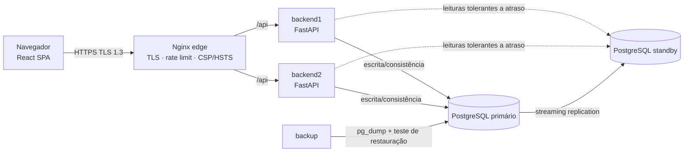
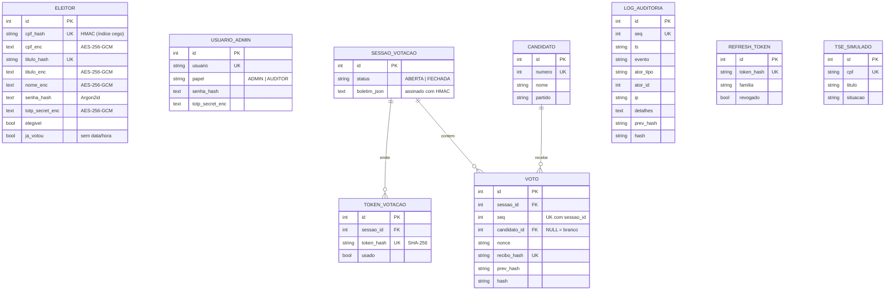

# Documentação técnica – Voto Seguro

Disciplina: Segurança e Auditoria de Sistemas – UNOESC · Equipe: Eduardo de Lima Toledo, Gustavo de Mattos Calliari, Paulo Ricardo Sanches

## 1. Arquitetura

* **Rede**: `interna` (sem internet; backends, bancos e backup) e `publica` (só o `edge` publica portas).
* **Backends stateless**: todo estado fica no banco (sessão = JWT + refresh token no banco); qualquer instância atende qualquer requisição.
* **Contêineres endurecidos**: usuário não-root, sistema de arquivos somente leitura, `cap_drop: ALL`, `no-new-privileges`.
* **Réplica**: leituras que toleram pequeno atraso (candidatos, logs, relatórios, ledger) usam o standby; se ele cair, `get_db_ro` volta ao primário. Escritas, votos e autenticação usam sempre o primário.

## 2. Modelo de dados

**Não existe nenhuma chave, coluna ou tabela que ligue `ELEITOR` a `TOKEN_VOTACAO` ou a `VOTO`.** `ja_votou` não tem data/hora, `TOKEN_VOTACAO` e `VOTO` não têm timestamp e `VOTO` não referencia o token.

## 3. Contrato da API (REST/JSON)

Base `/api`. Documentação OpenAPI interativa em `/api/docs`. Autenticação: `Authorization: Bearer <JWT>`.

| Método e rota | Papel | Descrição |
|---|---|---|
| `POST /auth/cadastro` | público | Valida CPF+título na base TSE simulada, cria conta, devolve segredo/URI do MFA |
| `POST /auth/login` | público | Senha → devolve `mfa_token` (não dá acesso a nada) |
| `POST /auth/mfa` | público | `mfa_token` + código TOTP → JWT de acesso (10 min) + refresh em cookie HttpOnly |
| `POST /auth/refresh` | cookie + CSRF | Rotaciona o refresh token e emite novo JWT |
| `POST /auth/logout` · `GET /auth/me` | autenticado | Revoga refresh · identifica o chamador |
| `GET /votacao/candidatos` | público | Lista candidatos e sessão atual |
| `GET /votacao/situacao` | ELEITOR | Sessão aberta? Já votou? Elegível? |
| `POST /votacao/token` | ELEITOR | **Passo 1**: marca "já votou" e entrega token descartável (uma vez) |
| `POST /votacao/votar` | **só o token** | **Passo 2**: grava o voto na cadeia; devolve recibo |
| `POST /votacao/recibo/verificar` | público | Confere se o recibo está na urna (posição e hashes) |
| `GET /votacao/ledger/{sessao}` | público | Livro público: posição, hash do recibo, hash encadeado (sem candidato) |
| `GET /admin/painel` | ADMIN | Situação da sessão e participação (sem parciais por candidato) |
| `POST /admin/sessao/abrir` · `/fechar` | ADMIN | Abre sessão · fecha, verifica cadeia, apura e assina o boletim |
| `GET /admin/boletim/{id}` | ADMIN, AUDITOR | Boletim de urna com assinatura HMAC |
| `GET /auditoria/logs` · `/verificar` · `/relatorio` | AUDITOR, ADMIN | Trilha de eventos · recontagem de hashes · relatório para fiscais |
| `GET /monitor/status` | ADMIN, AUDITOR | Nós do backend, primário e réplica (atraso) |
| `GET /saude` | interno | Health check do balanceador |

## 4. Segurança

### 4.1 Anonimato e integridade do voto
**Separação identidade × voto (token descartável).** O eleitor autentica (senha + MFA) e chama `POST /votacao/token`. Em **uma transação**, com a linha do eleitor travada (`SELECT … FOR UPDATE`), o sistema marca `ja_votou = true` e cria um token aleatório de 256 bits, **guardado só como hash** e sem referência ao eleitor. O token vai ao navegador; o voto é enviado depois (`POST /votacao/votar`) **sem credencial de identidade**, apenas com o token, que é consumido de forma atômica (`UPDATE … WHERE usado = false`, uma única linha afetada). Resultado: o servidor de aplicação e o administrador do banco veem "alguém recebeu um token" e "um token foi usado para um voto", mas não há dado que una os dois lados (o token nunca é gravado em claro; o voto não guarda o hash do token).

**Cadeia de hashes dos votos.** Cada voto tem `seq`, `prev_hash` e `hash = SHA-256(seq | sessão | candidato | nonce | recibo_hash | prev_hash)`; o primeiro aponta para um *genesis* da sessão. Alterar, remover ou inserir um voto quebra a cadeia a partir daquele ponto (testado em `tests/test_core.py`, inclusive o caso em que o atacante recalcula o hash do registro adulterado). A escrita é serializada por *advisory lock* do PostgreSQL.

**Âncora de fechamento.** Remover os **últimos** votos não quebra a cadeia sozinha. Por isso, ao fechar, `total_votos` e `hash_final` são gravados também na **cadeia de logs**; a verificação compara a cabeça atual com a âncora (também testado).

**Recibo e não-repúdio.** O recibo é um segredo aleatório devolvido ao eleitor; o banco guarda só `SHA-256(recibo)`. Com o recibo, o eleitor confere em `/votacao/recibo/verificar` que o voto está na urna e em que posição, sem que o recibo revele o candidato (o candidato não faz parte do que o recibo prova). Qualquer pessoa confere o livro público em `/votacao/ledger`.

**Boletim.** O boletim de urna é assinado com HMAC-SHA256 (chave `BOLETIM_KEY`) e verificado ao ser exibido.

### 4.2 Criptografia
* **Em trânsito:** Nginx aceita **somente TLS 1.3** (`ssl_protocols TLSv1.3`), HSTS de 2 anos, HTTP redireciona para HTTPS. O certificado de demonstração é autoassinado; em produção monte um certificado real em `/etc/nginx/certs`.
* **Em repouso:** CPF, título, nome e segredo TOTP em **AES-256-GCM** (nonce aleatório, contexto autenticado por campo, detecta adulteração). Busca por CPF usa **índice cego** (HMAC-SHA256), sem decifrar. Senhas com **Argon2id**. Refresh tokens e tokens de votação são guardados só como hash.
* **Chaves:** quatro chaves independentes (`AES_KEY`, `INDEX_KEY`, `JWT_KEY`, `BOLETIM_KEY`) vindas do ambiente; em `APP_ENV=production` a ausência de qualquer uma impede a inicialização.

### 4.3 Autenticação e autorização
* **MFA obrigatório para todos os perfis** (TOTP RFC 6238 implementado com a biblioteca padrão e validado com o vetor oficial). O código aceito não pode ser reutilizado (*anti-replay*).
* **Fluxo em duas etapas:** a senha correta só rende um `mfa_token` (tipo `mfa`, 5 min), rejeitado em qualquer rota protegida; só o MFA emite o JWT de acesso (tipo `access`, 10 min).
* **Refresh token** opaco em cookie `HttpOnly; Secure; SameSite=Strict`, com **rotação** a cada uso, proteção **CSRF** (double-submit) e detecção de reutilização (token já rotacionado derruba toda a "família" e gera evento de auditoria).
* **Bloqueio por tentativas:** 5 falhas (senha ou MFA) bloqueiam a conta por 15 min. Mensagem única ("credenciais inválidas ou conta bloqueada") e verificação de senha sempre executada, para não revelar se a conta existe (enumeração por mensagem/tempo).
* **RBAC:** `ELEITOR`, `ADMIN` (mesário), `AUDITOR` (fiscal). O fiscal só lê; só o mesário abre/fecha sessão; o eleitor só vota.

### 4.4 Proteção contra ataques comuns
| Ameaça | Mitigação |
|---|---|
| Força bruta / abuso | *Rate limiting* em duas camadas: Nginx (`limit_req`, vale entre instâncias) e API (por IP, em memória) em login, MFA, cadastro e votação; bloqueio de conta |
| SQL Injection | SQLAlchemy ORM com parâmetros; nenhuma consulta monta SQL com entrada do usuário (o pouco SQL "cru" usa constantes ou identificadores validados) |
| XSS | React escapa saída; **CSP** `default-src 'self'` sem `unsafe-inline`/`unsafe-eval`; nenhum `style=` inline; JWT de acesso só em memória (não em `localStorage`) |
| CSRF | Cookie de refresh `SameSite=Strict` + double-submit; demais rotas usam `Bearer` (não é enviado automaticamente) |
| Clickjacking / sniffing | `X-Frame-Options: DENY`, `frame-ancestors 'none'`, `X-Content-Type-Options: nosniff`, `Referrer-Policy`, `Permissions-Policy` |
| Voto duplicado | `ja_votou` com lock de linha + token de uso único atômico; tentativas viram eventos de auditoria |
| Adulteração no banco | Cadeia de hashes + âncora + **triggers append-only** (UPDATE/DELETE/TRUNCATE bloqueados em `voto` e `log_auditoria`) + conta da API **sem** `UPDATE/DELETE/TRUNCATE` nessas tabelas (`REVOKE`) |
| Vazamento de erro | Handler global devolve mensagem genérica; sem stack trace; versões de Nginx/Uvicorn ocultas |
| Corpo gigante / lentidão | `client_max_body_size 16k`, timeouts curtos no Nginx, validação Pydantic com limites de tamanho |

## 5. Auditoria
* **Trilha append-only com hash encadeado** (`log_auditoria`): `hash = SHA-256(seq | ts | evento | ator | ip | detalhes | prev_hash)`; trigger impede alterar/apagar; conta da API sem privilégio de `UPDATE/DELETE`.
* **Eventos registrados:** cadastro, login (senha, MFA, sucesso, falha, bloqueio), emissão de token, tentativa de voto duplicado/rejeitada, abertura/fechamento de sessão, reutilização de refresh token. **O conteúdo do voto nunca é registrado**, e votos não geram log individual (um log com horário permitiria correlacionar token e voto).
* **Relatórios para fiscais** (`/auditoria/relatorio`, botão "Baixar relatório"): totais por sessão, contagem de eventos e resultado da verificação.
* **Verificação de integridade** (`/auditoria/verificar`): recalcula a cadeia de votos e a de logs, confere a âncora de fechamento e a conciliação (votos = tokens usados; tokens emitidos = eleitores marcados). Ao fechar, o sistema aborta se a cadeia estiver corrompida.
* **Cenário de fraude para o seminário:** `docker compose --profile demo run --rm demo-fraude` executa, nesta ordem: (1) voto normal; (2) o mesmo eleitor tenta votar de novo → recusado e registrado; (3) reuso do token → recusado e registrado; (4) lista os eventos; (5) verificação **íntegra**; (6) um "DBA malicioso", com a conta dona do banco, desliga o trigger e troca o candidato de um voto; (7) a verificação acusa **a posição exata** e o motivo; (8) restaura e a cadeia volta a ser íntegra.

## 6. Redundância e contingência
* **Banco:** PostgreSQL 16 em *streaming replication* (primário + standby *hot standby*, slot físico `replica1_slot`, usuário de replicação dedicado, autenticação SCRAM). O painel de monitoramento mostra estado e atraso.
* **Backend:** duas instâncias stateless atrás do Nginx; uma que falhe sai da rotação (`max_fails`/`fail_timeout`) e o Nginx tenta a outra em erros de conexão/502/503. Health check em `/saude` (consulta o banco).
* **Backup automatizado com teste de restauração:** a cada ciclo (padrão 1 h) o serviço `backup` gera `pg_dump` (formato custom, com SHA-256), **restaura num banco temporário, compara a contagem de linhas das tabelas críticas** e grava o resultado em `/backups/ULTIMO_TESTE`; mantém os últimos 24. Restauração manual: `docker compose run --rm --entrypoint /restaurar.sh backup /backups/<arquivo>.dump`.

### Plano de contingência (queda durante a votação)
| Situação | Efeito | Ação |
|---|---|---|
| Uma instância do backend cai | Nenhum para o eleitor | Nginx redireciona; reiniciar o nó (`docker compose up -d backend1`) |
| Standby cai | Leituras voltam ao primário; votação intacta | Recriar o standby (`docker compose up -d db-replica`; refaz `pg_basebackup`) |
| **Primário cai** | Escritas param (login, token, voto) | 1) Mesário comunica a pausa. 2) `docker compose exec -u postgres db-replica pg_ctl promote -D /var/lib/postgresql/data` promove o standby. 3) Apontar `DATABASE_URL` dos backends para ele e reiniciá-los. 4) Rodar `/auditoria/verificar` antes de reabrir. Eleitores que já receberam o token **mantêm o token** (guardado na aba) e votam assim que o serviço volta |
| Perda dos dados | — | Restaurar o último dump verificado e conferir a cadeia + âncora |
| Borda (Nginx) cai | Indisponibilidade total | `docker compose up -d edge`; em produção, 2 nós de borda com IP virtual |

**Fila de votos:** o próprio desenho em dois passos funciona como fila de contingência: o token emitido não expira durante a sessão, e o navegador o guarda em `sessionStorage` para retomar após queda/recarga.

## 7. Limitações conhecidas (honestidade técnica)
1. **Anonimato não é absoluto contra um administrador que observe o sistema em tempo real.** Quem acompanhar, ao mesmo tempo, as requisições de `/token` e `/votar` poderia correlacionar pelo horário e pelo IP. Mitigações já aplicadas: nenhum timestamp em token/voto, nenhum log individual de voto, `ja_votou` sem hora. Mitigações possíveis: atraso aleatório no passo 2, *mix-net*, ou **assinatura cega** (RSA blind signature) no lugar do token simples, que removeria essa correlação mesmo com todos os registros do servidor.
2. A ordem dos votos na cadeia reflete a ordem de chegada; embaralhar na apuração (ou usar fila com *commit* em lote) reduziria o risco do item 1.
3. **Rate limiting da API é por instância** (memória); a defesa que vale entre instâncias é a do Nginx. Em produção, usar Redis.
4. Certificado TLS autoassinado e segredos TOTP fixos existem **apenas para demonstração** (`SEED_DEMO=true`).
5. O `ja_votou` é resetado ao abrir uma nova sessão (cada sessão = uma eleição/turno); a conciliação por contagem cobre a sessão mais recente.
6. Failover do primário é manual (passo documentado); automação exigiria Patroni/repmgr.
7. O teste de restauração compara contagens (pode acusar divergência se houver voto entre o `pg_dump` e a contagem; repetir o ciclo confirma).
8. Esta é uma simulação acadêmica: **não** substitui a urna eletrônica nem atende requisitos legais do TSE.

## 8. Roteiro sugerido para o seminário (≈15 min)
1. **Arquitetura** (2 min): diagrama da seção 1; mostrar `docker compose ps`.
2. **Proteção do voto** (5 min): votar como eleitor; mostrar no banco que não há vínculo (`\d voto`, `\d token_votacao`); mostrar o recibo e conferi-lo; apresentar a cadeia.
3. **Detecção de fraude** (4 min): rodar `demo-fraude`; mostrar o painel de Auditoria acusando a posição adulterada.
4. **Recuperação de falhas** (3 min): `docker compose stop backend1` (painel Monitoramento mostra o nó fora, sistema segue); `stop db-replica`; mostrar `ULTIMO_TESTE` do backup.
5. **Limitações e evolução** (1 min): seção 7.
